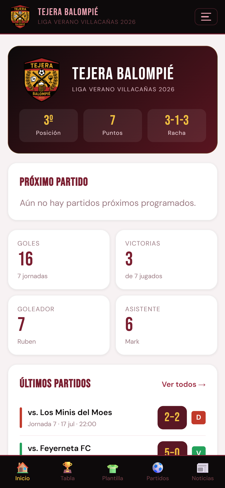
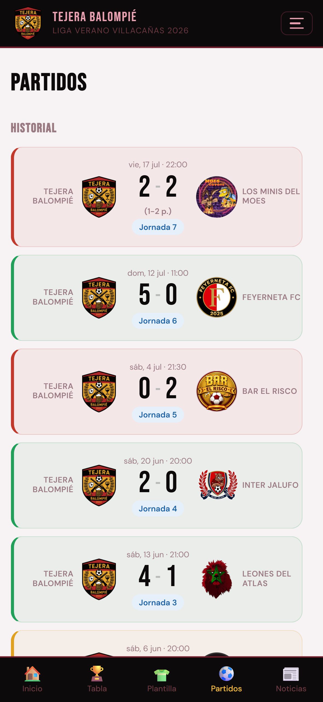
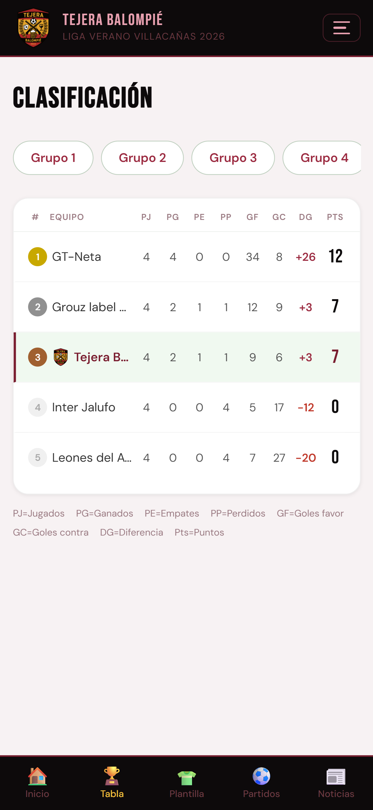
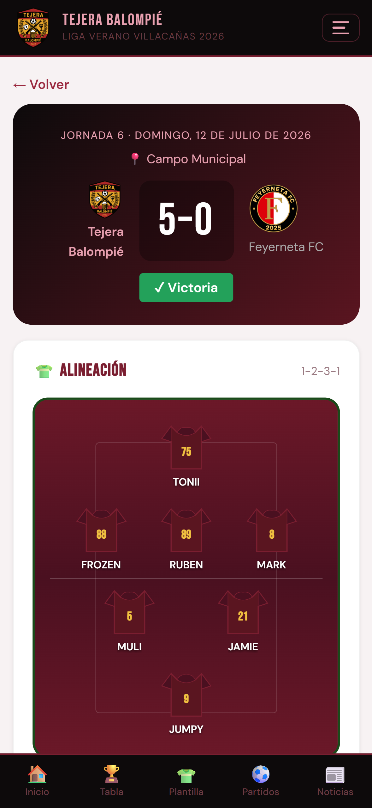
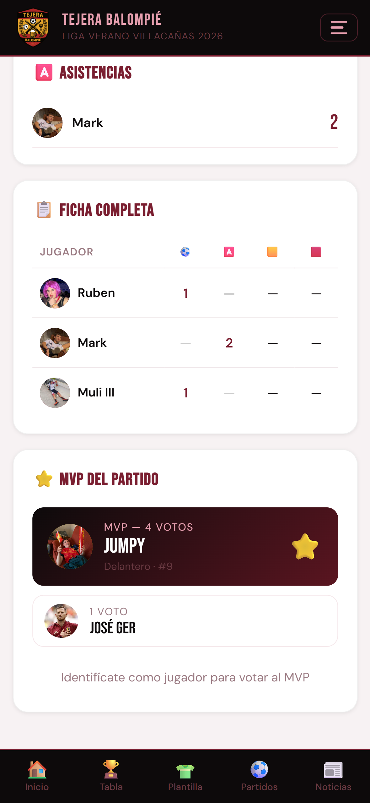
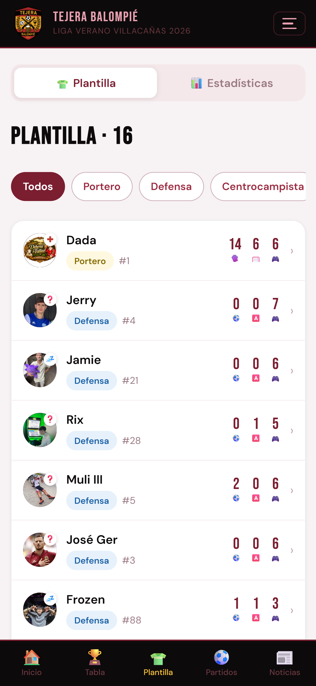
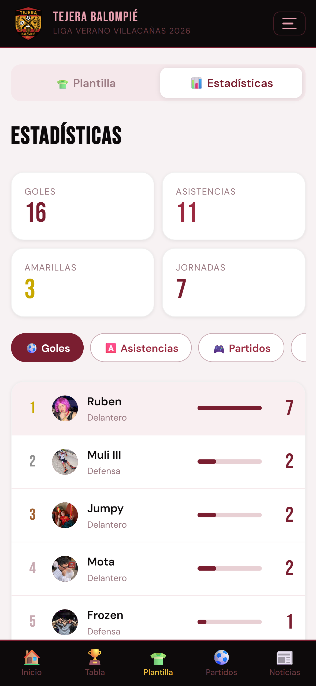
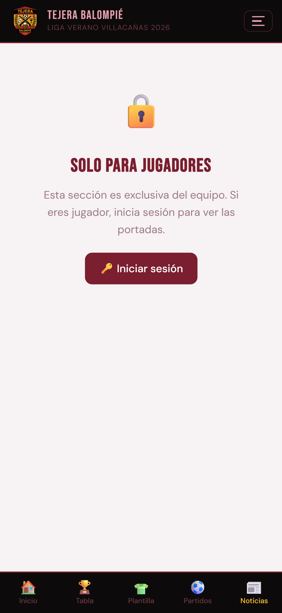
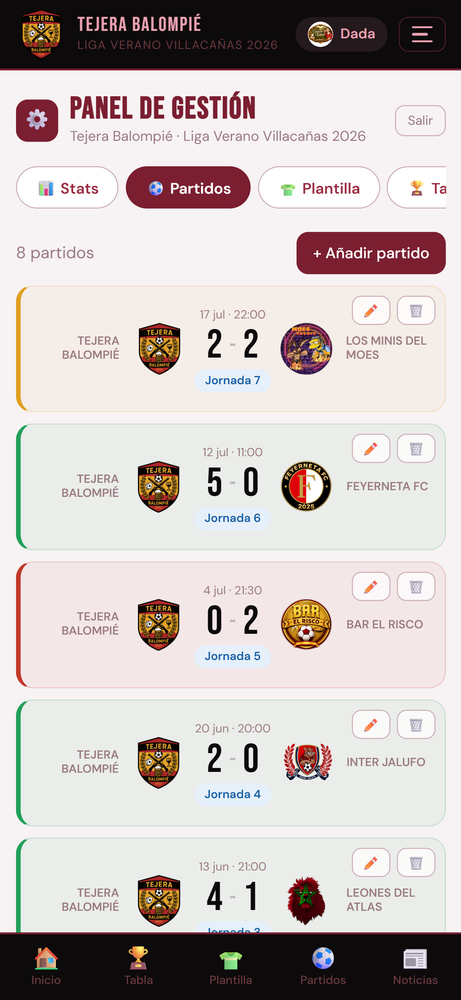
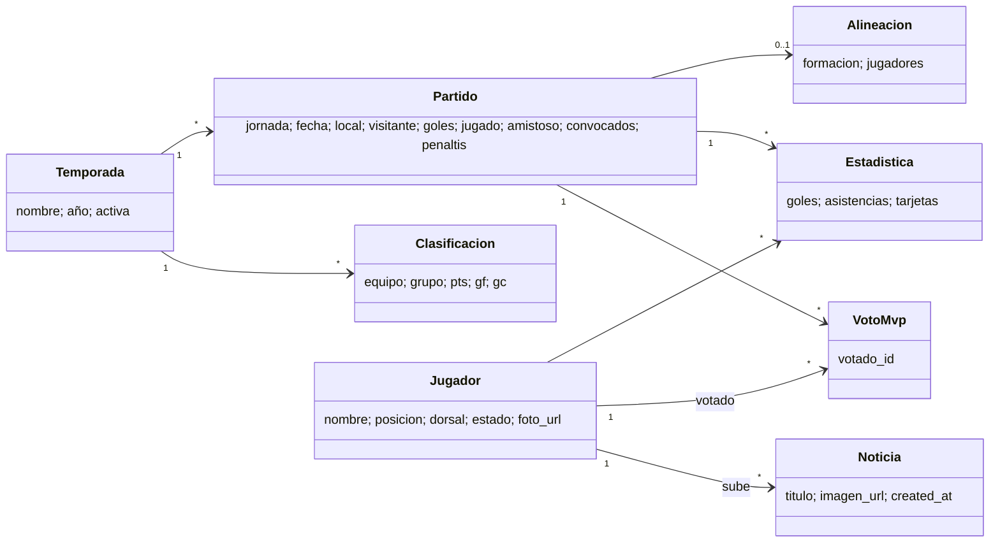

# ⚽ Tejera Balompié — Summer League Team App (React + Supabase)


The app of **Tejera Balompié**, the team my friends and I play with in a local **7-a-side summer league**. It records the whole season — results, line-ups, league table, stats and a man-of-the-match vote — and gives the squad a private space of its own. It installs on any phone like a native app.

> ☀️ **Real-world project, built with AI.** I built this app for my own team and we use it every summer to run the season: **[tejera-balompie.vercel.app](https://tejera-balompie.vercel.app)**
> The code was written with **[Gemini](https://gemini.google.com)** (Google) as a pair programmer. See [How it was built](#-how-it-was-built) for what was done by me and what by the AI.
>
> It was the first version of the idea that later became [**cd-tembleque-fc**](https://github.com/ivangomezr/cd-tembleque-fc), a more complete app for an 11-a-side club.

---

## 📸 Screenshots

| Home | Matches | League table |
|---|---|---|
|  |  |  |

| Line-up | MVP voting | Squad |
|---|---|---|
|  |  |  |

| Season stats | Team covers (members only) | Admin panel |
|---|---|---|
|  |  |  |

---

## ✨ Features

### For everyone

- **Home**: next match, latest results and top scorers.
- **Matches**: upcoming and played fixtures, league and friendly matches, including games decided on **penalties**.
- **Match detail**:
  - **7-a-side line-up** drawn on a pitch with the team kit and shirt numbers, in four formations (1-3-2-1, 1-2-3-1, 1-2-2-2, 1-1-3-2);
  - call-up, goals, assists and cards of the match;
  - **penalty shootout** with every kick recorded.
- **MVP vote** after each match, with a live ranking. The winner's shirt is highlighted on the pitch. One vote per player, which can be changed.
- **League table** by group, sorted by points, goal difference and goals scored. It opens on our own group by default.
- **Season stats**: goals, assists, cards and goalkeeper stats.
- **Squad**: photo, position, number and **availability** (available, injured, doubtful, suspended, out), with an **in-app image cropper** for profile photos.
- **Season history**: pick any past summer and get its **season summary** — record, goals for and against, and the top-three rankings for scorers, assists, cards and least-beaten goalkeeper. Friendlies are left out, so the numbers are the ones that actually count.
- **Sponsors** page.
- **Installable PWA** with haptic feedback, pull-to-refresh and specific fixes for scrolling and modals on iOS.

### 📰 Team covers — the squad's private corner

The feature the team uses the most, and the reason the app beats a WhatsApp group.

Any player can upload a **cover** to the news section: photos from the match, but above all the running joke of the dressing room — we take the front page of a Spanish sports paper like **Marca** or **AS**, put our own faces on it and rewrite the headlines around our games. The season ends up with a gallery of front pages telling its story.

- **Members only.** The section is locked for anyone who isn't signed in: visitors see a lock screen with a login button, never the images. It isn't just the interface hiding them — the database itself refuses to serve a single row of `noticias` without a valid session.
- **Upload with a title**, from the phone, in two taps.
- **Push notification** to the whole squad when a new cover goes up, so nobody misses it.
- **Full-screen viewer** and paged loading (four at a time).

### For admins

- **Admin panel** with tabs for stats, matches, squad, league table and seasons.
- **Seasons**: closing a season and starting the next one are two separate actions, and the database guarantees that **only one season can be active** at a time.
- **Activity log** (superadmin only): every change made from the panel, with who made it.
- **Three roles**: player, admin and superadmin.

---

## 🧰 Tech Stack

| Layer | Technology |
|---|---|
| Frontend | **React 18** + **React Router 6**, built with **Vite 5** |
| Backend | **Supabase**: PostgreSQL, Row Level Security, RPC functions, Edge Functions |
| Auth | Passwords hashed with **bcrypt** (`pgcrypto`) and session tokens, all server-side |
| Images | **Cloudinary** (unsigned uploads), in-app cropper |
| Notifications | Web Push (VAPID) through the `send-push` Edge Function |
| Hosting | **Vercel** |
| CI | GitHub Actions: Supabase keep-alive |

---

## 🏗️ Architecture

A single-page app with one page per route. All data goes through a **store** (`src/lib/store.js`) that talks to Supabase. Without Supabase keys it falls back to `localStorage` with sample data, so the app runs locally with zero setup.

| Route | Page |
|---|---|
| `/` | Home |
| `/partidos` · `/partido/:id` | Fixtures and match detail (line-up, events, penalties, MVP vote) |
| `/clasificacion` | League table by group |
| `/estadisticas` | Season stats |
| `/jugadores` | Squad and player availability |
| `/noticias` | Team covers (members only) |
| `/historial` | Past seasons and their summary |
| `/patrocinadores` | Sponsors |
| `/admin` | Admin panel (staff only) |

### Security

The first version of the app checked passwords in the browser and let anyone with the public key write to the database. It was rebuilt:

- **Authentication happens on the server.** Passwords are stored as **bcrypt** hashes in a `privado` schema that PostgREST does not expose, and are checked by `SECURITY DEFINER` functions. Logging in returns a session token that lasts 8 hours; only its SHA-256 is stored, so a dump of the table yields no usable sessions. Five failed attempts lock the account for a while.
- **Writing requires a valid session.** The client sends its token in an `x-sesion-token` header and **Row Level Security** checks it on every table. Hiding buttons in React is only a convenience: the database rejects anything the role isn't allowed to do.
- **Least privilege.** Seasons can only be changed by the superadmin; a player can only create and delete their own MVP vote; the activity log is written per session and read only by the superadmin; push subscriptions can't be read through the API at all, only written through functions.
- **`noticias` is members-only at the database level**, not just in the UI.
- **No secrets in the frontend.** The bundle carries only the public Supabase anon key; every `VITE_*` variable ends up in the published JavaScript, so nothing else is kept there.

Each migration in `supabase/migrations/` explains at the top what it changes and why, and the riskier ones ship with an undo script in `supabase/rollback/`.

### Design decisions

Some decisions that aren't obvious from the code alone:

- **Images moved to Cloudinary.** Images were first stored in Supabase Storage, but the egress traffic was getting close to the free-plan limit. Moving them to Cloudinary took that traffic off the main backend.
- **Keep-alive with GitHub Actions.** Free Supabase projects are paused after a period of inactivity, which breaks the project's DNS. Since the app is only used in summer, a workflow (`supabase-keep-alive.yml`) pings the project every few days to keep it active all year.
- **Friendlies excluded from the season summary.** Mixing them in inflated everyone's numbers, so the summary counts only official matches.

### Domain model



---

## 📁 Project Structure

```
tejera-balompie/
├── src/
│   ├── lib/                    # Store, Supabase client, auth, push, haptics, sample data
│   ├── components/             # Navbar, Alineacion, Camiseta, ImageCropper, PullIndicator
│   ├── pages/                  # One file per route
│   └── hooks/                  # useStore, usePullToRefresh, useFadeIn
├── public/                     # Crest, icons, manifest and service worker
├── supabase/
│   ├── migrations/             # SQL schema, server-side auth, RLS, private news
│   ├── rollback/               # Undo scripts for the riskier migrations
│   └── functions/send-push/    # Web push Edge Function
├── .github/workflows/          # Supabase keep-alive
├── screenshots/
└── vercel.json                 # SPA rewrites
```

---

## 🚀 Running Locally

**No backend needed to try it.** Without Supabase keys the app runs in **local mode** with sample data stored in `localStorage`.

### Prerequisites
- Node.js 18+
- *(Optional)* A Supabase project, plus Cloudinary and VAPID keys for uploads and push notifications

### Steps
1. Clone the repository and install the dependencies:
   ```bash
   git clone https://github.com/ivangomezr/tejera-balompie.git
   cd tejera-balompie
   npm install
   ```
2. *(Optional)* Copy `.env.example` to `.env.local` and fill in your keys.
3. Start the dev server and open `http://localhost:5173`:
   ```bash
   npm run dev
   ```

### Connecting Supabase
1. Create a project at [supabase.com](https://supabase.com).
2. Run the files in `supabase/migrations` in order from the SQL Editor, or apply them with the Supabase CLI.
3. Set the admin and superadmin passwords from the SQL Editor — they are **not** in the repository:
   ```sql
   SELECT asignar_clave_admin('admin', 'your-password');
   SELECT asignar_clave_admin('superadmin', 'your-password');
   ```
4. Give each player a password with `SELECT asignar_clave_jugador(<id>, '<password>');`.

### Environment variables

| Variable | Required | Description |
|---|---|---|
| `VITE_SUPABASE_URL` | yes | Supabase project URL |
| `VITE_SUPABASE_ANON_KEY` | yes | Supabase anon (public) key |
| `VITE_CLOUDINARY_CLOUD_NAME` · `VITE_CLOUDINARY_UPLOAD_PRESET` | no | Image uploads |
| `VITE_VAPID_PUBLIC_KEY` | no | Web push |

### Deploying to Vercel
Import the repository in Vercel (preset **Vite**) and add the variables above. Every push to `main` deploys production.

---

## ⚖️ Data and images

- **Players**: names, photos and stats of the team's players are shown with their consent. This data lives in the app's database, not in this repository. Any player can ask for their data or photo to be removed.
- **Team covers**: the covers uploaded by the squad are private to the team and are never shown to visitors or included in this repository.
- **Other teams**: team names and results are shown only to identify the teams in the league table and fixtures.
- **Screenshots** in this README show real team data with the players' permission.

---

## 🤖 How it was built

This project was developed with **AI-assisted programming**: I worked with **Gemini** (Google) as a pair programmer, and most of the code and SQL was written by the AI from my instructions.

**My part:**
- **Product**: deciding what the team needed and the rules of each feature — how the MVP vote works, which stats to track, who can edit what, and that the covers had to be members-only.
- **Review and testing**: trying every change on real phones and with real match data, finding bugs and asking for fixes.
- **Security**: spotting that authentication was happening in the browser and that the database accepted writes from anyone, and driving the rebuild to server-side auth with Row Level Security.
- **Setup and operations**: Supabase (database, RPC functions, Edge Functions), Vercel, Cloudinary, environment variables, the keep-alive workflow and keeping an eye on the free-plan limits.
- **Running it for real**: the app is used every summer by the team to record the whole season.

For projects that show my own programming skills, see my coursework repositories: [opel-cars-jpa](https://github.com/ivangomezr/opel-cars-jpa), [spanish-beaches-jpa](https://github.com/ivangomezr/spanish-beaches-jpa), [word-guesser-game](https://github.com/ivangomezr/word-guesser-game), [pokemon-pair-matching-game](https://github.com/ivangomezr/pokemon-pair-matching-game) and [pokedex-xml-xslt](https://github.com/ivangomezr/pokedex-xml-xslt).

---

## 🙋 Author

**Iván Gómez** — [@ivangomezr](https://github.com/ivangomezr)

Built for **Tejera Balompié** as a personal project, with AI-assisted development (Gemini).
